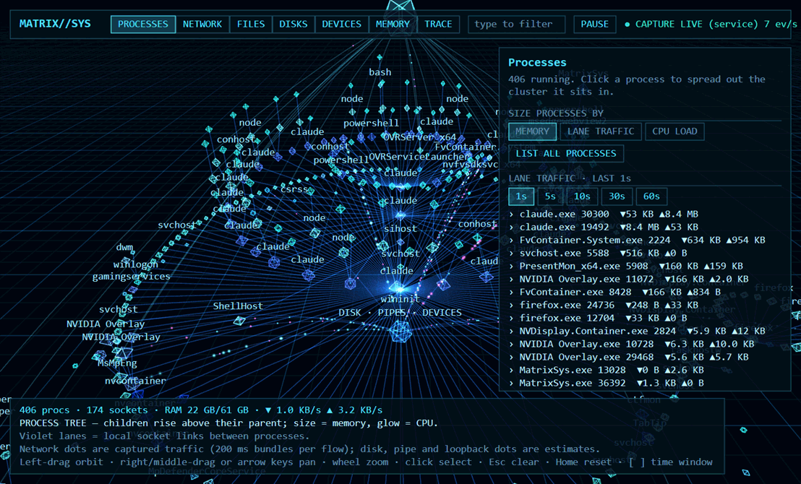
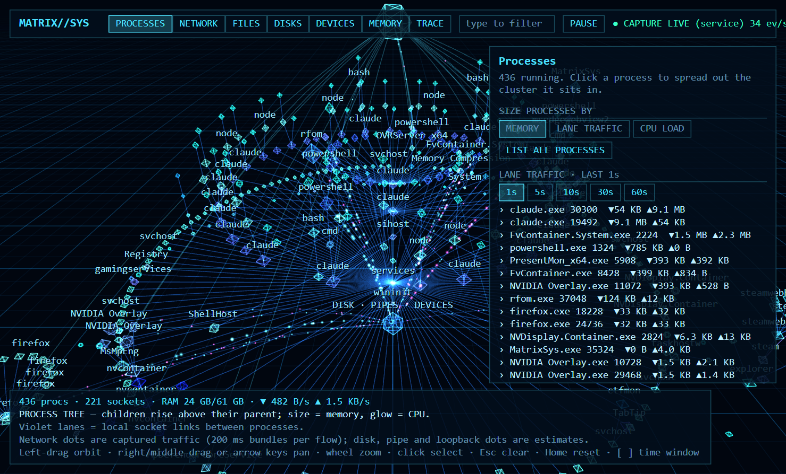
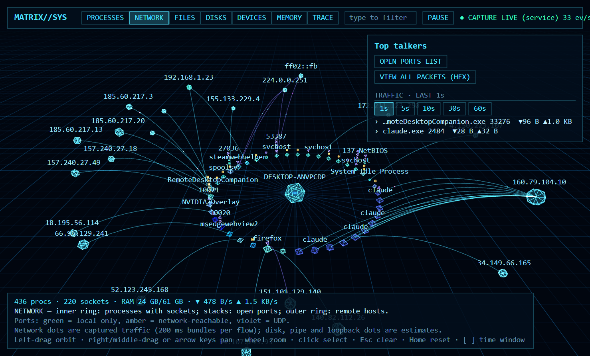
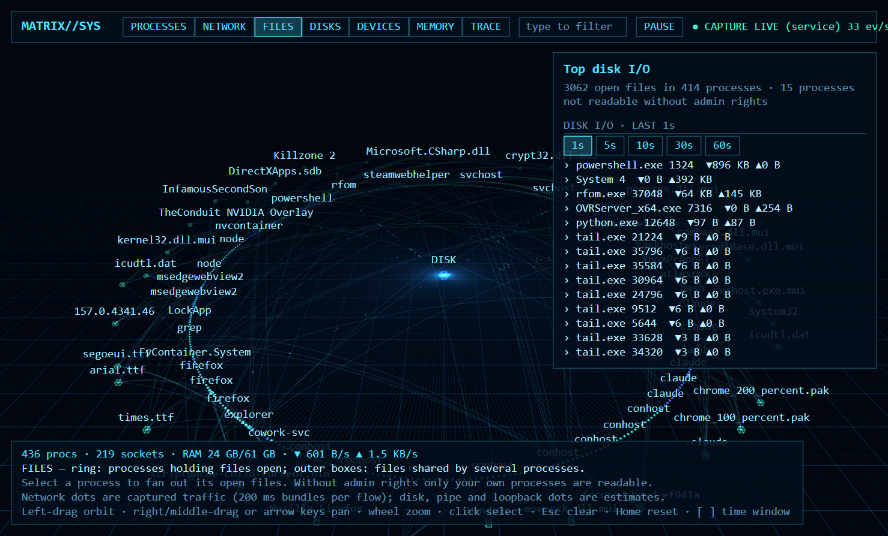
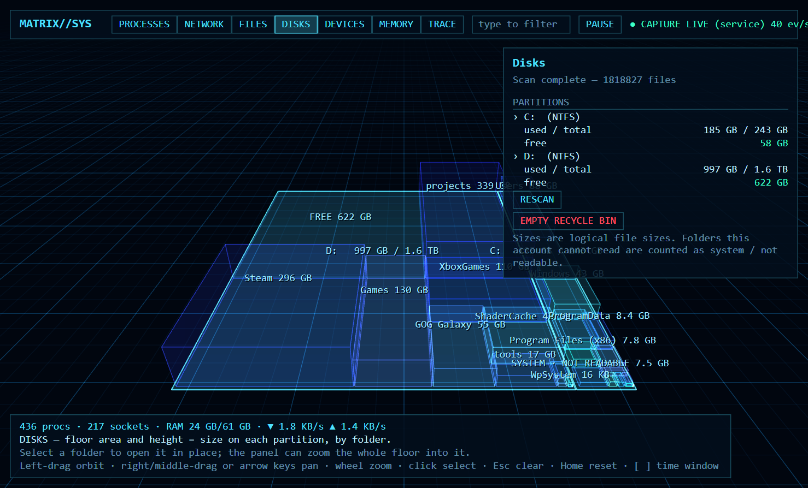
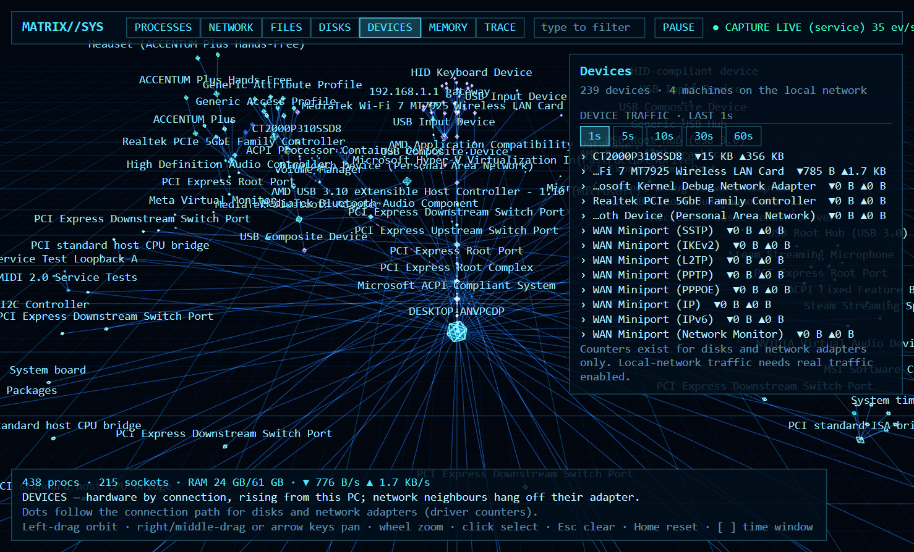
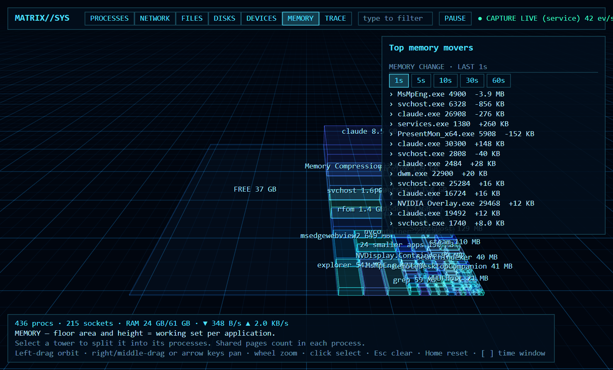
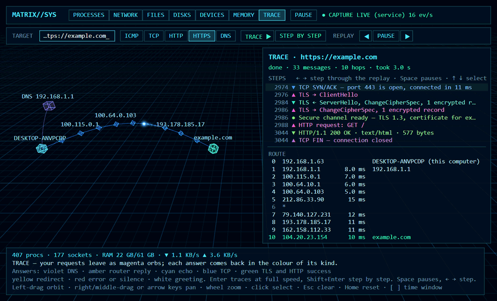
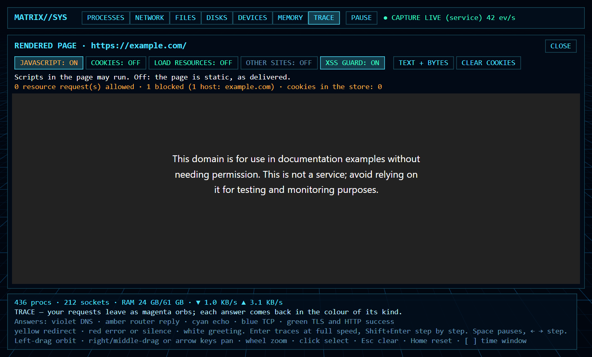

# MatrixSys

[](https://github.com/VictorMarcinschi/matrix-sys-win11/actions/workflows/build.yml)
[](https://github.com/VictorMarcinschi/matrix-sys-win11/releases/latest)
[](LICENSE)

A native, fully offline 3D visualizer of a Windows 11 machine: processes, the data they exchange, network traffic, memory, open files, disks and devices, with controls to act on what it shows. Type a host name and watch every router and every message between you and it. Dark scene, glowing blue-cyan wireframes.



## Download

Get the latest version from the **[Releases page](https://github.com/VictorMarcinschi/matrix-sys-win11/releases/latest)**:

- **MatrixSys-Setup-….exe** installs it, with optional shortcuts, background capture service and web page renderer.
- **MatrixSys-…-portable.zip** runs without installing: unzip and start `MatrixSys.exe`.

Windows 11, 64-bit. Both files are built by GitHub Actions from the public source and are not code-signed yet, so Windows SmartScreen will say the publisher is unknown; choose *More info* and *Run anyway* if you trust the build. `SHA256SUMS.txt` on the release lists their checksums.

Questions, ideas, screenshots of your own machine: [Discussions](https://github.com/VictorMarcinschi/matrix-sys-win11/discussions). Bugs and feature requests: [Issues](https://github.com/VictorMarcinschi/matrix-sys-win11/issues). Want to help? See [CONTRIBUTING.md](CONTRIBUTING.md).

## Views

### Processes

The process tree in 3D, with lanes for data exchanged between processes. Size can stand for memory, lane traffic or CPU load.



### Network

Processes, their ports and remote hosts; one dot per packet when capture is live.



### Files

Which process has which files open.



### Disks

Every partition, used and free space, broken down by folder recursively.



### Devices

Connected hardware, network neighbours, and traffic between them.



### Memory

Treemap of physical memory by program.



### Trace

Type a host, an IP address or a URL and pick a protocol (ICMP, TCP, HTTP, HTTPS, DNS; a prefix such as `https://` selects it). Shows the name lookup, every router on the way and the whole conversation as orbs travelling between the nodes, with each request and response decoded (DNS records, TLS handshake and certificate, HTTP headers and body) and viewable as bytes. Enter runs the trace at full speed and replays it; Shift+Enter runs it step by step (Right arrow performs the next real step, Space runs it live or pauses, Left arrow goes back).



An HTML response can be shown as a rendered page, with switches for JavaScript, cookies, resources and an XSS guard (see [Rendered pages](#rendered-pages-optional)).



Also: lists of processes by lane traffic and of open ports, a packet viewer with hex dump, a process memory viewer, reverse DNS and owner lookup for remote addresses, and actions (suspend, kill, priority, firewall block, close connection, recycle folder, eject device, and more). Dangerous actions are red and ask for confirmation.

## Build

Requires Visual Studio 2022 or later with the C++ tools, and Python 3 only if you change the icon. The only third-party files are Microsoft's WebView2 header and loader in `native/webview2/`, used by the optional page renderer.

```bat
native\build.bat
```

Output goes to `native\out\`:

- `MatrixSys.exe` – the app.
- `MatrixSys-Setup.exe` – the installer (shortcuts, optional background service started at boot, uninstaller).

Every push is built by GitHub Actions; pushing a tag such as `v0.4.1` also publishes a release. See [CONTRIBUTING.md](CONTRIBUTING.md) for how the code is laid out.

## Rendered pages (optional)

An HTML response in the Trace tab can be shown as a rendered page. This needs `WebView2Loader.dll` next to the exe (an optional component in the installer) and the Microsoft Edge WebView2 runtime that ships with Windows 11. Without either, responses are shown as text.

The page shown is the response the trace captured; the document is never fetched again. Switches, all off by default except the last: JavaScript, cookies, loading resources from the network, resources from other sites, and an XSS guard (a Content-Security-Policy that only lets script files from the page's own site run). Links, redirects, popups, downloads, permission prompts and script dialogs are always blocked. The renderer keeps its profile in `%LOCALAPPDATA%\MatrixSys\WebView`; uninstalling removes it.

## Privileges

The app runs unprivileged and shows estimated traffic. **REQUEST ADMIN** relaunches it elevated to capture real packets. The optional service does the accounting at boot so the unprivileged app gets real numbers; the service never captures packet contents.

Command-line switches: `--tray`, `--select <pid>`, `--memory <pid>`, `--size <0|1|2>` (size processes by memory, lane traffic or CPU load), `--trace <target> [icmp|tcp|http|https|dns] [step]`, `--demo-packets`, `--install-service`, `--uninstall-service`, `--service-console`, `--uninstall`.

## Layout

| Path | What |
|---|---|
| `native/main.cpp` | scene, layout, rendering (Direct3D 11), UI (Direct2D), actions |
| `native/data.h` | process, socket and capture collection (ETW, raw sockets) |
| `native/trace.h` | the Trace tab's engine: DNS over UDP, hop discovery, TCP, TLS (Schannel), HTTP |
| `native/web.h` | optional rendered view of captured HTML responses (Microsoft Edge WebView2) and its safety switches |
| `native/webview2/` | Microsoft WebView2 SDK files: `WebView2.h`, `WebView2Loader.dll`, their licence |
| `native/svc.h` | background service, named-pipe protocol, install/uninstall |
| `native/disks.h` | disk scan |
| `native/devs.h` | device tree and counters |
| `native/setup.cpp` | installer |
| `native/make_icon.py` | icon generator |
| `index.html`, `server.py`, `collector.ps1`, `capture.py` | the first, web-based prototype (superseded by the native app) |
| `MatrixSys-macOS-prompt.md` | specification for a macOS port |

## Security

See [SECURITY.md](SECURITY.md) for what the app and its optional service do, what it sends over the network, and how to report a vulnerability privately.

## License

[MIT](LICENSE)
